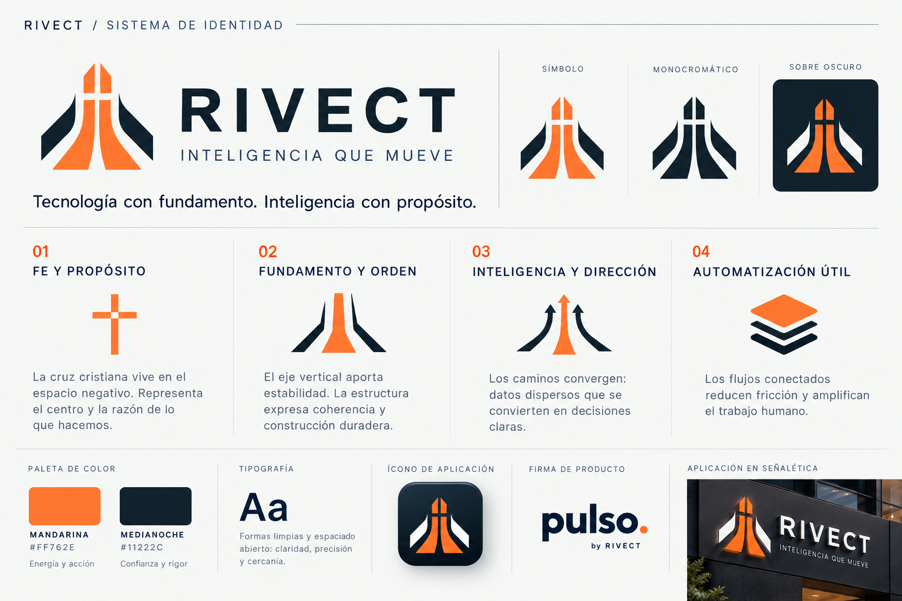

# RIVECT · Sistema de identidad

## Idea central

**Tecnología con fundamento. Inteligencia con propósito.**

RIVECT es la marca de la empresa; Pulso es su producto. La identidad une dirección, orden y movimiento: transformar información dispersa en acciones que ayudan a trabajar mejor.

## Qué significa cada elemento

| Elemento | Significado y decisión de diseño |
| --- | --- |
| Cruz cristiana en el espacio negativo | Referencia sutil a la fe y al propósito de la empresa, solicitada por su fundador. Está integrada en el vacío central para que forme parte de la construcción del símbolo. |
| Eje vertical | Sugiere fundamento, estabilidad y una dirección clara. Organiza visualmente las piezas. |
| Caminos interiores | Representan datos y procesos que convergen para producir decisiones y acciones útiles. |
| Formas exteriores | Enmarcan el núcleo y aportan estructura: la tecnología necesita un sistema que la sostenga. |
| Naranja mandarina | Aporta energía y visibilidad. Se eligió un naranja vivo, alejado del cobre anterior. |
| Azul medianoche | Equilibra el naranja y comunica rigor y confianza. |
| Tipografía sin serifas y espaciado abierto | Busca lectura clara y una presencia sobria, contemporánea y cuidada. El SVG incluye una familia de respaldo para facilitar su uso. |

Estas asociaciones explican la intención del diseño; no son medidas objetivas de rendimiento ni una certificación de exclusividad legal.

## Paleta

| Color | Código | Uso |
| --- | --- | --- |
| Mandarina | `#FF762E` | Acento, símbolo y acciones destacadas |
| Medianoche | `#11222C` | Logotipo y superficies oscuras |
| Pizarra | `#405C6B` | Descriptor y texto secundario |
| Blanco | `#FFFFFF` | Fondo y versión negativa |

## Archivos

- **rivect-identidad.png**: lámina de presentación con concepto, significado, paleta y aplicaciones ilustrativas.
- **rivect-logo.svg**: composición principal con descriptor, para fondos claros.
- **rivect-simbolo.svg**: símbolo independiente, para avatar o icono.
- **rivect-monocromatico.svg**: una tinta, para usos donde el color no está disponible.
- **rivect-negativo.svg**: versión para fondos oscuros; conserva el naranja.
- **palette.json**: colores para implementación.

Los SVG son los archivos maestros para reproducción. La lámina es una presentación rasterizada; sus aplicaciones son ejemplos visuales.

## Criterios de uso

Mantener las proporciones y el espacio negativo de la cruz. Usar fondos lisos con contraste suficiente, reservar aire alrededor de la marca y evitar sombras, biseles o degradados añadidos. A tamaños pequeños, usar el símbolo y omitir el descriptor si deja de leerse.

El nombre del logotipo está compuesto con texto SVG: para producción gráfica con reproducción tipográfica idéntica en todos los equipos, convertir el texto a curvas en la herramienta de diseño elegida antes de enviarlo a imprenta.
